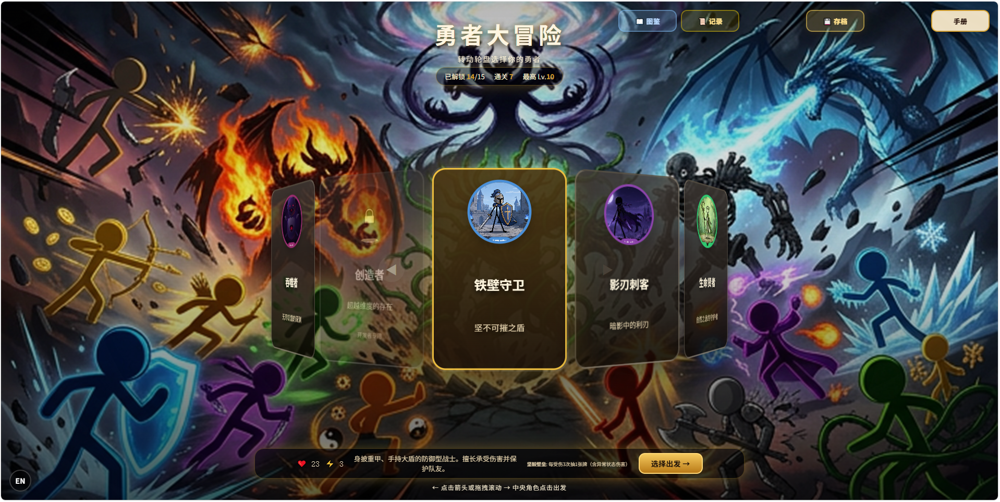
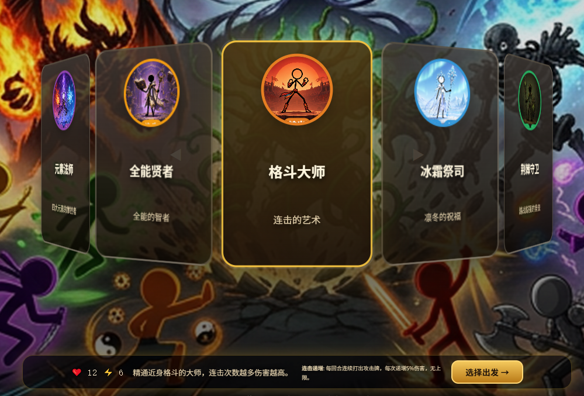
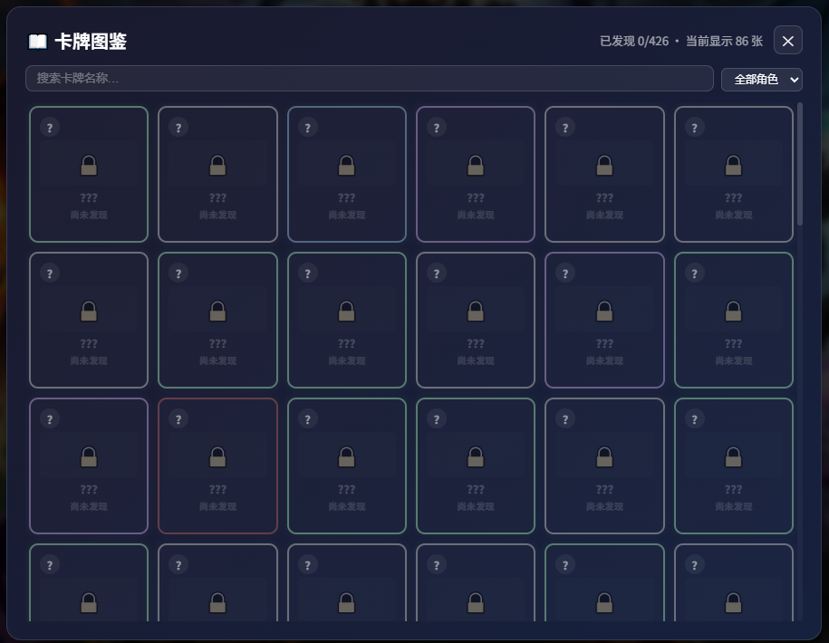

# Brave Adventure Card Game | 勇者大冒险

A bilingual browser-based roguelike deck-building game built with React and TypeScript.

一款支持中英双语、可直接在浏览器中运行的 Roguelike 卡牌构筑游戏。

[Play on itch.io](https://lorenzowuw.itch.io/brave-adventure-card-game) · [中文说明](#中文说明) · [English](#english)



## English

### Overview

Brave Adventure is a single-player card battler in which the player selects a hero, builds a deck, explores branching encounters, and develops a strategy across repeated runs. The project combines turn-based combat, character progression, card collection, persistent unlocks, and bilingual UI support in a web application.

### Highlights

- **Bilingual interface:** switch between Chinese and English during play.
- **Multiple playable heroes:** distinct character identities and combat styles.
- **Deck-building combat:** acquire, upgrade, remove, and combine cards throughout a run.
- **Roguelike progression:** branching encounters, shops, rest sites, events, elites, and bosses.
- **Persistent systems:** save slots, run history, unlock tracking, and card/enemy codices.
- **Content and balance tooling:** scripts for card generation, translation checks, difficulty tuning, and data audits.
- **Browser deployment:** packaged as a Vite application and published as a playable itch.io build.

### Tech Stack

| Area | Technology |
| --- | --- |
| Front end | React 18, TypeScript, CSS |
| Build tooling | Vite 5 |
| Testing | Vitest |
| Game data | JSON-driven characters, cards, enemies, events, and blessings |
| Persistence | Browser local storage and save-slot logic |
| Deployment | Single-file web build for itch.io |

### Selected Screens

| Character roster | Card codex |
| --- | --- |
|  |  |

### Local Development

Requirements: Node.js 18 or newer.

```bash
npm install
npm run dev
```

Then open the local URL printed by Vite.

### Build and Test

```bash
npm run test
npm run build
```

The production build is written to `dist/`.

### Project Structure

```text
src/
├── components/    UI for battles, maps, cards, shops, saves, and codices
├── data/          Game content stored as structured JSON
├── i18n/          Chinese and English interface text
├── systems/       Run state, combat, progression, saves, and unlock logic
├── types/         TypeScript domain models
└── utils/         Data loading and shared helpers
scripts/           Content generation, validation, translation, and balancing tools
```

### Development Note

This project was developed with extensive generative-AI assistance during an AI game-development internship. AI was used to accelerate ideation, implementation, content generation, debugging, and iteration. The playable product, integration work, testing, balancing, bilingual adaptation, and deployment decisions were completed through an iterative human-directed development process.

## 中文说明

### 项目简介

《勇者大冒险》是一款单人 Roguelike 卡牌构筑游戏。玩家可以选择不同勇者，通过战斗、事件、商店、休息点和 Boss 关卡逐步构筑卡组，并在多次冒险中解锁新的角色和内容。

### 核心功能

- **中英双语：** 游戏过程中可以随时切换中文与英文界面。
- **多角色体系：** 不同角色拥有独立定位、数值和战斗风格。
- **卡组构筑：** 支持获得、升级、移除与组合卡牌。
- **Roguelike 流程：** 包含分支地图、随机事件、商店、精英与 Boss 战。
- **持久化系统：** 包含多档存档、冒险记录、全局解锁和卡牌／敌方图鉴。
- **平衡工具：** 项目内提供卡牌校验、难度调整、翻译同步和数值审计脚本。
- **网页部署：** 使用 Vite 构建，并已发布为可直接游玩的 itch.io 网页版本。

### 本地运行

需要 Node.js 18 或更高版本。

```bash
npm install
npm run dev
```

### 测试与构建

```bash
npm run test
npm run build
```

### AI 使用说明

本项目在 AI 游戏开发实习期间使用生成式 AI 辅助完成。AI 主要用于加速玩法构思、代码实现、内容生成、调试与迭代；产品整合、测试、平衡、中英双语适配与最终部署由开发者持续判断和推进。

## Links

- Playable build: https://lorenzowuw.itch.io/brave-adventure-card-game
- Portfolio: https://lorenzowuw.itch.io/

